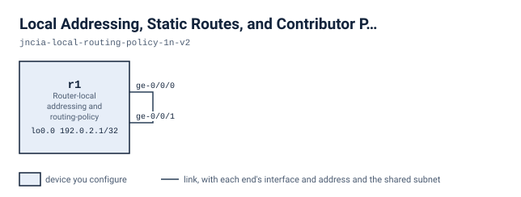

# Local Addressing, Static Routes, and Contributor Policy

On one router, r1, add an exact loopback service address, two static routes with different forwarding actions, and aggregate contributor policy. Fixed values: service 192.0.2.2/32 on lo0.0; discard route 172.16.10.0/24; reject route 172.17.10.0/24; approved contributor 172.16.10.0/24; aggregates 172.16.0.0/16 and 172.17.0.0/16.

## Scenario

You run r1, a single router used for local routing practice. Its two data ports, ge-0/0/0 and ge-0/0/1, are cabled to each other. Both are up, and the diagnostic address 192.0.2.1 answers. Three things are missing. There is no second service address. The two planned networks have no routes. The aggregate routes do not behave as the design says. You are asked to add the service endpoint and the two planned static routes. Then make only the approved contributor feed its aggregate, and keep the other aggregate defined but inactive.

## Before you start

`lab.yaml` records how much memory and how many cores this lab needs and where each node's image comes from. Every node boots into its starting state from its own file under `configs/`, so there is nothing to apply by hand before you begin: bring the lab up, wait until it says it is ready, and start on the first stage. The next section is every command you need.

If your own image is tagged differently, set `VJUNOS_ROUTER_IMAGE` before you deploy; the topology takes the tag from the environment and falls back to the default it names.

## Working with this lab

<!-- labpack:generated working-with-this-lab -->

This lab comes with a launcher that runs it for you. Every command below is run from this directory, and none of them asks you to type a sign-in.

| To do this | Run this |
| --- | --- |
| Set up the machine the labs run on, once | `labpack setup` |
| Check that machine against what this lab needs | `labpack doctor` |
| See which node images this lab needs | `labpack images` |
| Start the lab and wait until it is ready | `labpack start` |
| Open a session on one of its devices | `labpack connect r1` |
| See whether a stage's outcomes have been reached | `labpack check s1` |
| Ask for the author's hint | `labpack hint s1` |
| Put every device back to the starting state | `labpack reset` |
| Jump to the start of a stage | `labpack goto s1` |
| See a stage's answer | `labpack solution s1` |
| Shut the lab down and prove nothing is left | `labpack down` |

The first time, on a machine that has never run one of these labs, work through `labpack setup`: it asks where the labs should run, sets up the way in, checks the machine against what this lab needs, and walks through any node image that is missing. After that it is remembered and no later command needs to be told again.

The nodes of this lab are `r1`. Some of them may be fixtures rather than devices you work on; the drawing below says which.

This lab's stages are `s1`, `s2` and `s3`. Put the one you are working on after `labpack check`, `labpack hint`, `labpack goto` and `labpack solution`.

`labpack goto` and `labpack solution` need the full download. The student download carries no answers, and those two commands say so rather than guess.

You can also run this lab with nothing but the container runtime. `topology.clab.yml` is a plain topology file, every node boots its own starting state from a file under `configs/`, and each file under `checks/` states one outcome as data: which device to ask, what to ask it, and what the answer has to be. So you can read a check and look at the same outcome yourself.

<!-- /labpack:generated working-with-this-lab -->

## Topology

<!-- labpack:generated topology -->

| Node | Its part in this network |
| --- | --- |
| r1 | Router-local addressing and routing-policy practice |

| Node | Interface | Faces | Address |
| --- | --- | --- | --- |
| r1 | ge-0/0/0 | r1 | — |
| r1 | ge-0/0/1 | r1 | — |
| r1 | lo0.0 | no link | 192.0.2.1/32 |

The drawing and the tables above are the whole of the wiring: every node, every link, the interface each link is on at both of its ends, and the address each of them starts with. These are the interface names to use, and nothing in this lab needs any other interface. An interface with no address yet is shown without one.

<!-- /labpack:generated topology -->

## What is already built

r1 has ge-0/0/0 and ge-0/0/1 up/up and 192.0.2.1/32 on lo0.0. Aggregate 172.17.0.0/16 is already configured as passive, so it is active in the ordinary route view and absent from the hidden view. The service address 192.0.2.2/32, the two static routes and aggregate 172.16.0.0/16 do not exist yet. Leave the two data ports and the existing loopback address alone.

## Stage 1 — Establish the exact local service endpoint

Make lo0.0 carry the service address 192.0.2.2 with an exact host mask, and make it reachable from r1. The existing 192.0.2.1 address must stay.

**You're done when**

- The interface view of lo0.0 lists 192.0.2.2 alongside 192.0.2.1
- inet.0 holds a Direct route for 192.0.2.2/32
- r1 pings 192.0.2.2 with no loss

Hint: The mask decides which Direct prefix the router creates. Compare the interface view with the route view to see whether you got the one you meant.

<!-- labpack:generated check-your-work-s1 -->

**Check your work.** `labpack check s1`. Stuck? `labpack hint s1` gives you the author's hint for whichever outcome is not met yet.

<!-- /labpack:generated check-your-work-s1 -->

## Stage 2 — Represent the two planned networks

Create the two planned networks as static routes. Traffic to 172.16.10.0/24 must be dropped silently. Traffic to 172.17.10.0/24 must be dropped with an error response to the sender. Keep the stage 1 results.

**You're done when**

- 172.16.10.0/24 is an active Static route whose forwarding entry is a discard
- 172.17.10.0/24 is an active Static route whose forwarding entry is a reject
- The stage 1 outcomes still hold

Hint: The routing table shows both as Static. The forwarding table is where the two actions differ, so check it for each prefix.

<!-- labpack:generated check-your-work-s2 -->

**Check your work.** `labpack check s2`. Stuck? `labpack hint s2` gives you the author's hint for whichever outcome is not met yet.

<!-- /labpack:generated check-your-work-s2 -->

## Stage 3 — Distinguish rejected contribution from route deletion

Make aggregate 172.16.0.0/16 active, using only 172.16.10.0/24 as its contributor. Make aggregate 172.17.0.0/16 inactive through contributor policy, so that 172.17.10.0/24 is not accepted, but keep its definition in the configuration.

**You're done when**

- 172.16.0.0/16 is an active Aggregate in inet.0
- 172.17.0.0/16 is absent from the ordinary inet.0 view but present as an Aggregate in the hidden route view
- The earlier outcomes still hold

Hint: An aggregate is active only while it has a contributing route. Ask what currently keeps 172.17.0.0/16 active without one, and compare the ordinary and hidden route views for both aggregates.

<!-- labpack:generated check-your-work-s3 -->

**Check your work.** `labpack check s3`. Stuck? `labpack hint s3` gives you the author's hint for whichever outcome is not met yet.

<!-- /labpack:generated check-your-work-s3 -->

## Checking your work

Each outcome of this exercise is written as a check under `checks/`. `checks/baseline.yaml` states what is true before you start and must stay true, and one file per stage states that stage's outcome. Every check names the device and the command it reads, so you can run them with the launcher for this format or read the file and check the outcome by hand.

## Tearing down

Destroy the lab with the same tool you deployed it with, and confirm that nothing of it is left running. A lab left up holds the memory and the cores the next one needs.
