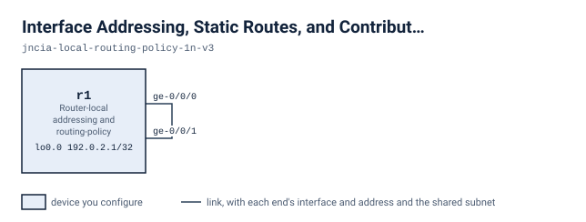

# Interface Addressing, Static Routes, and Contributor Policy

On a single router, r1, you add a service address on ge-0/0/0.0, create a discard and a reject static route, and use policy so that only the approved contributor builds aggregate 172.16.0.0/16 while 172.17.0.0/16 stays defined but hidden.

## Scenario

You have r1, a single router whose two ports are cabled to each other. It has a diagnostic loopback address and nothing else. The team has planned two networks, 172.16.10.0/24 and 172.17.10.0/24, and wants r1 to handle them in a controlled way. One aggregate, 172.17.0.0/16, was defined earlier and shows as active in the ordinary route view, which is not what the team wants. You give r1 a service endpoint, represent the two planned networks as static routes that drop traffic differently, and make the aggregates follow the contributor rule: only the approved contributor counts.

## Before you start

`lab.yaml` records how much memory and how many cores this lab needs and where each node's image comes from. Every node boots into its starting state from its own file under `configs/`, so there is nothing to apply by hand before you begin: bring the lab up, wait until it says it is ready, and start on the first stage. The next section is every command you need.

If your own image is tagged differently, set `VJUNOS_ROUTER_IMAGE` before you deploy; the topology takes the tag from the environment and falls back to the default it names.

## Working with this lab

<!-- labpack:generated working-with-this-lab -->

This lab comes with a launcher that runs it for you. Every command below is run from this directory, and none of them asks you to type a sign-in.

| To do this | Run this |
| --- | --- |
| Set up the machine the labs run on, once | `labpack setup` |
| Check that machine against what this lab needs | `labpack doctor` |
| See which node images this lab needs | `labpack images` |
| Start the lab and wait until it is ready | `labpack start` |
| Open a session on one of its devices | `labpack connect r1` |
| See whether a stage's outcomes have been reached | `labpack check s1` |
| Ask for the author's hint | `labpack hint s1` |
| Put every device back to the starting state | `labpack reset` |
| Jump to the start of a stage | `labpack goto s1` |
| See a stage's answer | `labpack solution s1` |
| Shut the lab down and prove nothing is left | `labpack down` |

The first time, on a machine that has never run one of these labs, work through `labpack setup`: it asks where the labs should run, sets up the way in, checks the machine against what this lab needs, and walks through any node image that is missing. After that it is remembered and no later command needs to be told again.

The nodes of this lab are `r1`. Some of them may be fixtures rather than devices you work on; the drawing below says which.

This lab's stages are `s1`, `s2` and `s3`. Put the one you are working on after `labpack check`, `labpack hint`, `labpack goto` and `labpack solution`.

`labpack goto` and `labpack solution` need the full download. The student download carries no answers, and those two commands say so rather than guess.

You can also run this lab with nothing but the container runtime. `topology.clab.yml` is a plain topology file, every node boots its own starting state from a file under `configs/`, and each file under `checks/` states one outcome as data: which device to ask, what to ask it, and what the answer has to be. So you can read a check and look at the same outcome yourself.

<!-- /labpack:generated working-with-this-lab -->

## Topology

<!-- labpack:generated topology -->

| Node | Its part in this network |
| --- | --- |
| r1 | Router-local addressing and routing-policy practice |

| Node | Interface | Faces | Address |
| --- | --- | --- | --- |
| r1 | ge-0/0/0 | r1 | — |
| r1 | ge-0/0/1 | r1 | — |
| r1 | lo0.0 | no link | 192.0.2.1/32 |

The drawing and the tables above are the whole of the wiring: every node, every link, the interface each link is on at both of its ends, and the address each of them starts with. These are the interface names to use, and nothing in this lab needs any other interface. An interface with no address yet is shown without one.

<!-- /labpack:generated topology -->

## Design values

| Item | Value |
| --- | --- |
| Service address | 192.0.2.2/24 on ge-0/0/0.0 |
| Discard route | 172.16.10.0/24 |
| Reject route | 172.17.10.0/24 |
| Approved aggregate | 172.16.0.0/16, contributor 172.16.10.0/24 |
| Unwanted aggregate | 172.17.0.0/16, contributor 172.17.10.0/24 rejected |

## Planned prefixes

| Prefix | Role | Expected |
| --- | --- | --- |
| 192.0.2.0/24 | Direct subnet | Direct |
| 172.16.10.0/24 | Static | discard |
| 172.17.10.0/24 | Static | reject |
| 172.16.0.0/16 | Aggregate | active |
| 172.17.0.0/16 | Aggregate | hidden |

## What is already built

r1 has ge-0/0/0 and ge-0/0/1 up and joined by a self-link, and lo0.0 holds 192.0.2.1/32. Aggregate 172.17.0.0/16 is defined as passive and is active in the ordinary route view. Leave the interfaces, the loopback and the link as they are. Nothing else is configured.

## Stage 1 — Establish the exact local service endpoint

Give r1 a service endpoint on its first wired port, ge-0/0/0, using the 192.0.2.2 address with the mask that makes 192.0.2.0/24 a connected subnet. The local subnet must be connected and reachable.

**You're done when**

- Operational state shows 192.0.2.2/24 on ge-0/0/0.0.
- inet.0 has an active Direct route 192.0.2.0/24.
- r1 pings 192.0.2.2 with no loss.

Hint: The connected route comes from the address and its mask on a specific unit. Read back the unit, address and prefix length before you look at the routing table.

<!-- labpack:generated check-your-work-s1 -->

**Check your work.** `labpack check s1`. Stuck? `labpack hint s1` gives you the author's hint for whichever outcome is not met yet.

<!-- /labpack:generated check-your-work-s1 -->

## Stage 2 — Represent the two planned networks

Create the two planned networks, 172.16.10.0/24 and 172.17.10.0/24, as local static routes that both drop traffic. The first must drop it silently. The second must drop it and signal that the destination is unreachable.

**You're done when**

- 172.16.10.0/24 is an active Static route with a Discard next hop and a discard entry in the forwarding table.
- 172.17.10.0/24 is an active Static route with a Reject next hop and a reject entry in the forwarding table.

Hint: Both routes have no real next hop, and the two behaviours differ in whether the sender is told. Check the forwarding table as well as the route view.

<!-- labpack:generated check-your-work-s2 -->

**Check your work.** `labpack check s2`. Stuck? `labpack hint s2` gives you the author's hint for whichever outcome is not met yet.

<!-- /labpack:generated check-your-work-s2 -->

## Stage 3 — Distinguish rejected contribution from route deletion

Use policy so that only the 172.16.10.0/24 contributor builds aggregate 172.16.0.0/16. Aggregate 172.17.0.0/16 must stay defined but be inactive and hidden, because its contributor is rejected.

**You're done when**

- 172.16.0.0/16 is an active Aggregate.
- 172.17.0.0/16 appears as Aggregate in the hidden view only.
- 172.17.0.0/16 does not appear in the ordinary route view.

Hint: An aggregate with no accepted contributor is kept hidden, not deleted. Something in the existing 172.17.0.0/16 definition keeps it active regardless of contributors. Find it and decide what the policy should accept.

<!-- labpack:generated check-your-work-s3 -->

**Check your work.** `labpack check s3`. Stuck? `labpack hint s3` gives you the author's hint for whichever outcome is not met yet.

<!-- /labpack:generated check-your-work-s3 -->

## Checking your work

Each outcome of this exercise is written as a check under `checks/`. `checks/baseline.yaml` states what is true before you start and must stay true, and one file per stage states that stage's outcome. Every check names the device and the command it reads, so you can run them with the launcher for this format or read the file and check the outcome by hand.

## Tearing down

Destroy the lab with the same tool you deployed it with, and confirm that nothing of it is left running. A lab left up holds the memory and the cores the next one needs.
