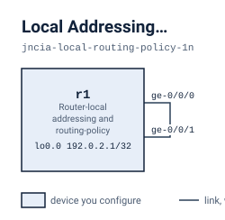

# Local Addressing, Static Routes, and Contributor Policy

On a single router, r1, you add a second loopback endpoint, create discard and reject static routes for two planned networks, and use an aggregate contributor policy so that only 172.16.0.0/16 is active and 172.17.0.0/16 disappears.

## Scenario

You run r1, a single router whose two data ports, ge-0/0/0 and ge-0/0/1, are cabled to each other. The diagnostic loopback 192.0.2.1/32 works. Two networks are planned, 172.16.10.0/24 and 172.17.10.0/24, and only the 172.16.0.0/16 summary is approved for use. You are asked to add a second service endpoint, represent the two planned networks locally, and control the aggregates so that the approved summary is active and the other one is gone.

## Before you start

`lab.yaml` records how much memory and how many cores this lab needs and where each node's image comes from. Every node boots into its starting state from its own file under `configs/`, so there is nothing to apply by hand before you begin: bring the lab up, wait until it says it is ready, and start on the first stage. The next section is every command you need.

If your own image is tagged differently, set `VJUNOS_ROUTER_IMAGE` before you deploy; the topology takes the tag from the environment and falls back to the default it names.

## Working with this lab

<!-- labpack:generated working-with-this-lab -->

This lab comes with a launcher that runs it for you. Every command below is run from this directory, and none of them asks you to type a sign-in.

| To do this | Run this |
| --- | --- |
| Set up the machine the labs run on, once | `labpack setup` |
| Check that machine against what this lab needs | `labpack doctor` |
| See which node images this lab needs | `labpack images` |
| Start the lab and wait until it is ready | `labpack start` |
| Open a session on one of its devices | `labpack connect r1` |
| See whether a stage's outcomes have been reached | `labpack check s1` |
| Ask for the author's hint | `labpack hint s1` |
| Put every device back to the starting state | `labpack reset` |
| Jump to the start of a stage | `labpack goto s1` |
| See a stage's answer | `labpack solution s1` |
| Shut the lab down and prove nothing is left | `labpack down` |

The first time, on a machine that has never run one of these labs, work through `labpack setup`: it asks where the labs should run, sets up the way in, checks the machine against what this lab needs, and walks through any node image that is missing. After that it is remembered and no later command needs to be told again.

The nodes of this lab are `r1`. Some of them may be fixtures rather than devices you work on; the drawing below says which.

This lab's stages are `s1`, `s2` and `s3`. Put the one you are working on after `labpack check`, `labpack hint`, `labpack goto` and `labpack solution`.

`labpack goto` and `labpack solution` need the full download. The student download carries no answers, and those two commands say so rather than guess.

You can also run this lab with nothing but the container runtime. `topology.clab.yml` is a plain topology file, every node boots its own starting state from a file under `configs/`, and each file under `checks/` states one outcome as data: which device to ask, what to ask it, and what the answer has to be. So you can read a check and look at the same outcome yourself.

<!-- /labpack:generated working-with-this-lab -->

## Topology

<!-- labpack:generated topology -->

| Node | Its part in this network |
| --- | --- |
| r1 | Router-local addressing and routing-policy practice |

| Node | Interface | Faces | Address |
| --- | --- | --- | --- |
| r1 | ge-0/0/0 | r1 | — |
| r1 | ge-0/0/1 | r1 | — |
| r1 | lo0.0 | no link | 192.0.2.1/32 |

The drawing and the tables above are the whole of the wiring: every node, every link, the interface each link is on at both of its ends, and the address each of them starts with. These are the interface names to use, and nothing in this lab needs any other interface. An interface with no address yet is shown without one.

<!-- /labpack:generated topology -->

## What is already built

r1 already has ge-0/0/0 and ge-0/0/1 up/up and lo0.0 carrying 192.0.2.1/32. An aggregate for 172.17.0.0/16 is configured and retained with the passive property. The address 192.0.2.2/32, both static routes and the 172.16.0.0/16 aggregate do not exist yet. Leave the interfaces and the diagnostic address alone.

## Stage 1 — Establish the local service endpoint

Give r1 the service address 192.0.2.2/32 on lo0.0, alongside the existing diagnostic 192.0.2.1.

**You're done when**

- lo0.0 carries 192.0.2.2/32 and inet.0 has a route for it
- r1 pings 192.0.2.2 with no loss

Hint: A /32 on the loopback creates its own local route. Check the mask and the unit.

<!-- labpack:generated check-your-work-s1 -->

**Check your work.** `labpack check s1`. Stuck? `labpack hint s1` gives you the author's hint for whichever outcome is not met yet.

<!-- /labpack:generated check-your-work-s1 -->

## Stage 2 — Represent the two planned networks

Create local routes for 172.16.10.0/24 with a discard next hop and 172.17.10.0/24 with a reject next hop. Neither needs a gateway.

**You're done when**

- 172.16.10.0/24 is an active Static route in inet.0 and its forwarding entry is a discard
- 172.17.10.0/24 is an active Static route in inet.0 and its forwarding entry is a reject

Hint: Static routes can point at a next-hop action instead of a neighbour. Decide which action belongs to which prefix before you type anything.

<!-- labpack:generated check-your-work-s2 -->

**Check your work.** `labpack check s2`. Stuck? `labpack hint s2` gives you the author's hint for whichever outcome is not met yet.

<!-- /labpack:generated check-your-work-s2 -->

## Stage 3 — Admit only the approved contributor

Make 172.16.0.0/16 an active aggregate whose only contributor is the exact approved route 172.16.10.0/24. Make 172.17.0.0/16 absent from inet.0. Keep both static routes and 192.0.2.2 working.

**You're done when**

- 172.16.0.0/16 is an active Aggregate route in inet.0
- inet.0 has no route for 172.17.0.0/16
- Both static routes and 192.0.2.2 still work

Hint: Think of an ordered policy: accept the one exact route you approve, then reject everything else. Then ask what keeps a contributor-less summary alive, and remove it.

<!-- labpack:generated check-your-work-s3 -->

**Check your work.** `labpack check s3`. Stuck? `labpack hint s3` gives you the author's hint for whichever outcome is not met yet.

<!-- /labpack:generated check-your-work-s3 -->

## Checking your work

Each outcome of this exercise is written as a check under `checks/`. `checks/baseline.yaml` states what is true before you start and must stay true, and one file per stage states that stage's outcome. Every check names the device and the command it reads, so you can run them with the launcher for this format or read the file and check the outcome by hand.

## Tearing down

Destroy the lab with the same tool you deployed it with, and confirm that nothing of it is left running. A lab left up holds the memory and the cores the next one needs.

When all three stages pass, r1 holds one approved active summary and nothing for the other.
