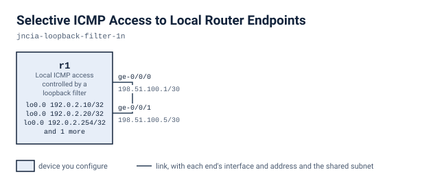

# Selective ICMP Access to Local Router Endpoints

r1 carries four loopback addresses and a loopback input filter that discards ICMP to some of them. You correct the filter in two stages so 192.0.2.10 and 192.0.2.20 answer while 192.0.2.30 stays silent.

## Scenario

You run r1. It has three local service addresses, 192.0.2.10, 192.0.2.20 and 192.0.2.30, and a diagnostic address, 192.0.2.254, all on lo0.0. A loopback input filter is meant to control who can ping which service. It doesn't do that now. Pings to some of the service addresses are discarded when they shouldn't be. The policy you have to reach: .10 and .20 answer ICMP, .30 does not, and the diagnostic address keeps working.

## Before you start

`lab.yaml` records how much memory and how many cores this lab needs and where each node's image comes from. Every node boots into its starting state from its own file under `configs/`, so there is nothing to apply by hand before you begin: bring the lab up, wait until it says it is ready, and start on the first stage. The next section is every command you need.

If your own image is tagged differently, set `VJUNOS_ROUTER_IMAGE` before you deploy; the topology takes the tag from the environment and falls back to the default it names.

## Working with this lab

<!-- labpack:generated working-with-this-lab -->

This lab comes with a launcher that runs it for you. Every command below is run from this directory, and none of them asks you to type a sign-in.

| To do this | Run this |
| --- | --- |
| Set up the machine the labs run on, once | `labpack setup` |
| Check that machine against what this lab needs | `labpack doctor` |
| See which node images this lab needs | `labpack images` |
| Start the lab and wait until it is ready | `labpack start` |
| Open a session on one of its devices | `labpack connect r1` |
| See whether a stage's outcomes have been reached | `labpack check s1` |
| Ask for the author's hint | `labpack hint s1` |
| Put every device back to the starting state | `labpack reset` |
| Jump to the start of a stage | `labpack goto s1` |
| See a stage's answer | `labpack solution s1` |
| Shut the lab down and prove nothing is left | `labpack down` |

The first time, on a machine that has never run one of these labs, work through `labpack setup`: it asks where the labs should run, sets up the way in, checks the machine against what this lab needs, and walks through any node image that is missing. After that it is remembered and no later command needs to be told again.

The nodes of this lab are `r1`. Some of them may be fixtures rather than devices you work on; the drawing below says which.

This lab's stages are `s1` and `s2`. Put the one you are working on after `labpack check`, `labpack hint`, `labpack goto` and `labpack solution`.

`labpack goto` and `labpack solution` need the full download. The student download carries no answers, and those two commands say so rather than guess.

You can also run this lab with nothing but the container runtime. `topology.clab.yml` is a plain topology file, every node boots its own starting state from a file under `configs/`, and each file under `checks/` states one outcome as data: which device to ask, what to ask it, and what the answer has to be. So you can read a check and look at the same outcome yourself.

<!-- /labpack:generated working-with-this-lab -->

## Topology

<!-- labpack:generated topology -->

| Node | Its part in this network |
| --- | --- |
| r1 | Local ICMP access controlled by a loopback filter |

| Node | Interface | Faces | Address |
| --- | --- | --- | --- |
| r1 | ge-0/0/0 | r1 | 198.51.100.1/30 |
| r1 | ge-0/0/1 | r1 | 198.51.100.5/30 |
| r1 | lo0.0 | no link | 192.0.2.10/32 |
| r1 | lo0.0 | no link | 192.0.2.20/32 |
| r1 | lo0.0 | no link | 192.0.2.254/32 |
| r1 | lo0.0 | no link | 192.0.2.30/32 |

The drawing and the tables above are the whole of the wiring: every node, every link, the interface each link is on at both of its ends, and the address each of them starts with. These are the interface names to use, and nothing in this lab needs any other interface. An interface with no address yet is shown without one.

<!-- /labpack:generated topology -->

## What is already built

lo0.0 holds the four /32 addresses. ge-0/0/0 and ge-0/0/1 are cabled to each other on r1 and are up. The filter lo0-icmp is already applied inbound on lo0.0. It discards ICMP to .10 and .20 and accepts everything else. Leave the addresses, the interfaces and the filter's application to lo0.0 alone. Change only what the filter does.

## Stage 1 — Restore the first service

Make 192.0.2.10 answer probes from r1 again. Don't weaken the filter for the other addresses, and don't remove the filter.

**You're done when**

- Three of three pings from r1 to 192.0.2.10 get replies.
- The diagnostic address 192.0.2.254 still answers.

Hint: Read the filter term by term. Find the term that matches ICMP to .10 and see what it does with the packet. Then ask what the next term would do if that one didn't match.

<!-- labpack:generated check-your-work-s1 -->

**Check your work.** `labpack check s1`. Stuck? `labpack hint s1` gives you the author's hint for whichever outcome is not met yet.

<!-- /labpack:generated check-your-work-s1 -->

## Stage 2 — Complete the service access policy

Allow 192.0.2.20 and deny 192.0.2.30 while keeping .10 reachable. The denial must apply to ICMP to .30 only.

**You're done when**

- Three of three pings from r1 to 192.0.2.20 get replies.
- Zero of three pings from r1 to 192.0.2.30 get replies.
- 192.0.2.10 still answers.

Hint: Terms are evaluated in order and the first match wins. Decide what each address needs, then check where a term that denies .30 sits relative to the term that accepts everything else.

<!-- labpack:generated check-your-work-s2 -->

**Check your work.** `labpack check s2`. Stuck? `labpack hint s2` gives you the author's hint for whichever outcome is not met yet.

<!-- /labpack:generated check-your-work-s2 -->

## Checking your work

Each outcome of this exercise is written as a check under `checks/`. `checks/baseline.yaml` states what is true before you start and must stay true, and one file per stage states that stage's outcome. Every check names the device and the command it reads, so you can run them with the launcher for this format or read the file and check the outcome by hand.

## Tearing down

Destroy the lab with the same tool you deployed it with, and confirm that nothing of it is left running. A lab left up holds the memory and the cores the next one needs.
